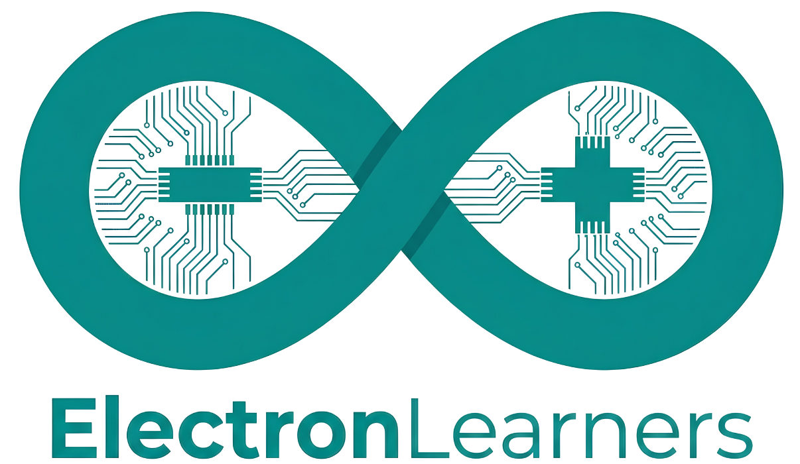

<div align="center">
  
  <h1>JR Learners</h1>
  <p><strong>Learn. Build. Innovate.</strong></p>
  <p>The JR Learners Arduino kit series: 8 levels, 50 guided projects per kit (400 in total), a free circuit simulator and an online shop with PayU payments.</p>
</div>

---

## The 8 kits

Every kit contains an Arduino UNO R3, USB cable, breadboard, jumper wires, resistor kit, push button and LEDs, plus the level-specific parts. Each kit has **10 Basic, 20 Intermediate and 20 Advanced** projects, and every project uses only the parts of its own kit.

| Level | Kit | Focus | Price |
|---|---|---|---|
| 1 | Foundations | digital I/O, PWM, analog read, serial | ₹848 |
| 2 | Sensing the World | analog and digital sensors, thresholds, calibration | ₹1,092 |
| 3 | Displays & Interfaces | LCD / OLED / 7-segment / matrix, shift registers, human input | ₹1,632 |
| 4 | Motion & Distance | ranging, presence and position sensing, first servo | ₹1,259 |
| 5 | Motors & Power Control | transistors, H-bridges, relays, steppers | ₹1,447 |
| 6 | Smart Safety & Environment | hazard detection, data sensing, alarms | ₹1,929 |
| 7 | Wireless & Remote Control | Bluetooth, 2.4 GHz radio, IR, Wi-Fi, 3.3 V interfacing | ₹2,066 |
| 8 | Smart Systems Capstone | RFID access, RTC logging, load cell, INA219, MPU6050, MAX30102 | ₹2,560 |

**All-in-One Kit (₹7,665):** the common core once (₹527.20) + the level-specific parts of all 8 kits (₹4,947.70) = ₹5,474.90, plus 40 %. That is ₹5,168 less than the eight kits bought separately (₹12,833).

**Pricing rule:** price = BOM component cost of the kit (including the common core) + 40 %, rounded to the nearest rupee. The server holds the same table in [backend/app/catalog.py](backend/app/catalog.py) and always recomputes the amount itself; the browser's total is never trusted.

## Site features

- **Shop** for the 8 kits: level filter, price filter, comparison table, parts list and the 50 projects on every kit page. Cart, wishlist, coupons, order history.
- **400 project guides** (`/projects`): parts list, circuit notes, Arduino sketch (copy / download .ino), neighbour navigation and a one-click link into the simulator.
- **ArduinoForge simulator** (`/simulator`, full screen at `/arduinoforge/`): breadboard circuit simulator with all 400 projects (`/arduinoforge/?example=k8-01-rfid-uid` opens one directly).
- **Downloads**: one ZIP of sketches per kit.
- **Accounts and orders**: users register and sign in (server-side, scrypt password hashes, signed 12-hour tokens, lock-out after 5 wrong passwords, rate limits); an account is required to order. Orders, accounts and enquiries live in the backend database.
- **E-mail**: every registration, order (paid or COD), contact form, support ticket and bulk quote is e-mailed to `admin@jrlearners.com`; customers get a confirmation copy.
- **Payments** with PayU (UPI, cards, netbanking, wallets, EMI) or Cash on Delivery, with server-side price checking and signature-verified callbacks.
- Courses, YouTube tutorials, blog, certificates with verification, school / teacher portals, support tickets, bulk quotes.
- Accessible colour theme: no pure black or white text, every text/background pair is checked for contrast.

## Repository layout

```
frontend/                 Next.js (static export, GitHub Pages)
  public/arduinoforge/    built ArduinoForge simulator (web app)
  public/kit-projects/    index.json + kit1..kit8.json (400 projects: parts, circuit notes, sketches)
  public/downloads/kits/  sketch ZIP per kit
  src/data/               productsData (the 8 kits), kitProjects, courses, blog, youtube
  src/pages/              shop, checkout, checkout/result, projects, simulator, ...
backend/                  FastAPI: catalogue, PayU payments, orders (SQLite)
  app/catalog.py          the 8 kits and their server-side prices
  app/payu.py             PayU hashes, verification, refunds
  app/main.py             API routes
Caddyfile + docker-compose.yml   self-hosted API with automatic HTTPS (any VPS with Docker)
```

## PayU payments

Flow: the checkout page sends the cart and customer details to `POST /api/v1/payments/payu/initiate`. The backend prices the cart from its own catalogue, stores a pending order, signs the PayU request with the **salt (which never leaves the server)** and returns the form fields. The browser posts them to PayU's hosted page. PayU sends the customer back to `POST /api/v1/payments/payu/callback`; the backend verifies PayU's response hash and the amount, marks the order `paid` or `failed` and redirects to `/checkout/result/`. A webhook (`/payments/payu/webhook`), a status re-check (`/payments/payu/verify/{txnid}`) and an admin refund endpoint are included.

### Set it up

1. **Backend** (self-hosted on any VPS with Docker; no third-party platform needed). Set these environment variables on the host, never in the repository:

   | Variable | Value |
   |---|---|
   | `PAYU_KEY`, `PAYU_SALT` | from the PayU dashboard (Key Salt Details) |
   | `PAYU_ENV` | `live` or `test` (test keys only work with `test`) |
   | `PUBLIC_API_URL` | the public URL of the backend, e.g. `https://api.jrlearners.com` |
   | `FRONTEND_URL`, `CORS_ORIGINS` | `https://jrlearners.com` |
   | `ADMIN_EMAIL`, `ADMIN_PASSWORD`, `SECRET_KEY` | the administrator account (created at start-up) and a long random string for signing tokens |
   | `SMTP_HOST`, `SMTP_PORT`, `SMTP_SECURITY`, `SMTP_USER`, `SMTP_PASSWORD`, `SMTP_FROM` | the mail server used to send notifications to `ADMIN_NOTIFY_EMAIL` (default `admin@jrlearners.com`). Until SMTP is set, messages wait in the `mail_outbox` table and are sent as soon as it is |
   | `TRUST_PROXY` | `1` behind Caddy / nginx (set in the compose file's env) |
   | `PAYU_CLIENT_ID`, `PAYU_CLIENT_SECRET` | only for the payment-links / split-payment APIs (not used by hosted checkout) |

   **Deploy on a VPS:** point an A record such as `api.jrlearners.com` at the server, install Docker, copy `backend/.env.example` to `backend/.env` and fill it in, then run `API_DOMAIN=api.jrlearners.com docker compose up -d --build`. Caddy gets a free HTTPS certificate automatically and the database lives in the `app_data` volume (back it up).

   For local work copy `backend/.env.example` to `backend/.env` (git-ignored) and run `cd backend && pip install -r requirements.txt && uvicorn app.main:app --reload`.

2. **PayU dashboard**: add the backend URL as the success / failure / webhook URL (`{PUBLIC_API_URL}/api/v1/payments/payu/callback` and `.../webhook`) if your account restricts return URLs.
3. **Front end**: add a GitHub repository variable `API_URL` (Settings, Secrets and variables, Actions, Variables) with the backend URL and re-run the deploy workflow. Until `API_URL` is set, the checkout offers Cash on Delivery only.

## Database

SQLite (file `jrlearners.db` in `DATA_DIR`, on the persistent disk, owner-only permissions). Tables: `users` (password hash, lock-out counters, role, profile), `orders` (belongs to a user), `inquiries`, `mail_outbox`, `audit_log`. Passwords are never stored in clear text. Back up the `/data` disk regularly.

## Contact

Help and support: help.jrlearners@gmail.com. YouTube: [@LetsGetEngagedin](https://www.youtube.com/@LetsGetEngagedin).

## Front end

```bash
cd frontend
npm install --legacy-peer-deps
npm run dev      # http://localhost:3000
npm run build    # static export to frontend/out
```

Deployed to GitHub Pages by `.github/workflows/deploy.yml` on every push to `main` (custom domain in `frontend/public/CNAME`).

## Colour theme

`frontend/src/styles/globals.css` ends with a generated contrast theme (generated by `frontend/scripts/gen_theme.py`): every surface (light, dark, saturated, bright) sets CSS variables for its text colours so a text utility such as `text-white` or `text-blue-400` resolves to a readable colour on the surface it sits on. Form fields are always a pale field with navy text.

---

YouTube: [@LetsGetEngagedin](https://www.youtube.com/@LetsGetEngagedin)
